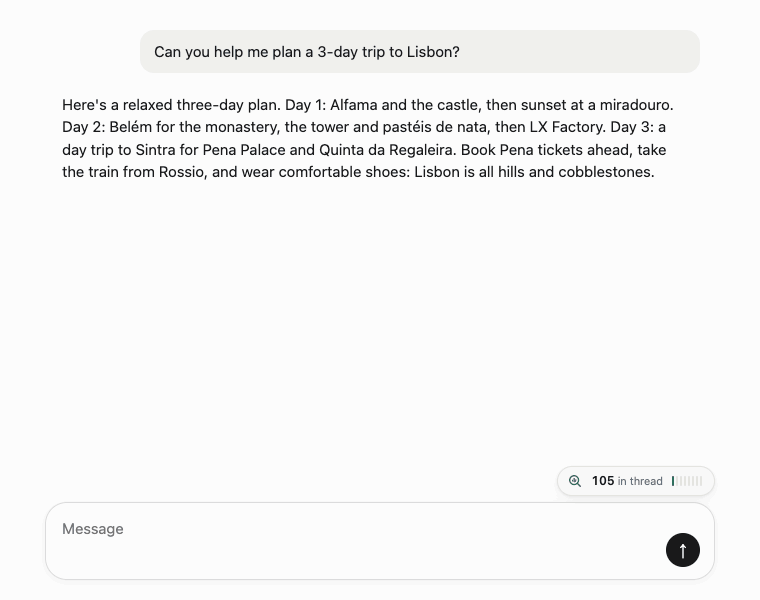

# Tokenlens

A small browser extension that adds a live token and cost meter to the chat box of Claude, ChatGPT, Gemini, DeepSeek, Grok, Perplexity and Mistral. Chrome and Firefox, plain JavaScript, no dependencies, no accounts.

It answers the question those sites don't: *how much of my limit is this message about to burn?*



**Private by design:** no account, no analytics, no server. Your prompts never leave the browser.

## What it does

- **Live estimate** next to the chat box: tokens for what you're typing, plus the conversation so far (every message re-sends the whole thread, which is where limits quietly disappear), plus a predicted reply length.
- **Reply prediction.** The reply length is predicted from your prompt: explicit requests ("in 100 words", "give me 5 ideas") are honoured, otherwise the kind of request (question, list, explanation, code, writing, summary, follow-up) sets the starting point, scaled up for long prompts and prompts that ask several things, and follow-ups like "continue" track the previous reply. After each reply it measures the real length and learns a per-model and per-kind average and spread (so the range narrows when a model is consistent), so predictions improve with use.
- **Cost in your currency.** Per-model API list prices, converted with daily exchange rates from [Frankfurter](https://frankfurter.dev). Falls back to built-in approximate rates offline.
- **Trim filler.** Removes greetings, "could you please", "basically", "in order to" and sign-offs such as "thanks in advance". It never touches code blocks, inline code, URLs, quoted strings, indentation or line breaks, and only drops "can you" before a plain request verb. You see the tokens saved before you click, and one click undoes it.
- **Context gauge.** Shows how full the model's context window is, and suggests a fresh chat when a thread gets heavy.
- **Daily budget.** Optional token budget with a 7-day history in the popup.

## Install

Download the zip for your browser from the latest release, or build them yourself (see Develop).

**Chrome, Edge, Brave, Arc** (Chrome 110+): unzip `tokenlens-chrome-*.zip` somewhere permanent, open `chrome://extensions`, enable *Developer mode*, choose *Load unpacked* and select the unzipped folder. Chromium browsers stop loading the extension if the folder is moved or deleted.

**Firefox** (140+): open `about:debugging#/runtime/this-firefox`, choose *Load Temporary Add-on* and select `manifest.json` from the unzipped `tokenlens-firefox-*.zip`. Temporary add-ons are removed when Firefox closes; for a permanent install, submit the zip to addons.mozilla.org.

> The Firefox build is untested; please open an issue if you hit problems.

The two builds differ only in `manifest.json`.

## How the estimate works

There's no tokenizer small enough to ship in a content script for every provider, so Tokenlens uses a structural estimate: short words are one token, long words are split, numbers group in threes, symbols and newlines count individually, CJK counts per character. For English prose that's typically within about 15% of the common tokenizers. Code and non-English text drift further. Treat it as a gauge, not an invoice.

Reasoning models spend hidden "thinking" tokens that never appear on the page, so Tokenlens cannot count them and will underestimate on those prompts.

Prices are **API list prices**, checked against each provider's own pricing page on 2026-10-12. The one exception is GPT-5.6 Luna, the model free ChatGPT users get, which isn't on OpenAI's pricing page; its price comes from third-party trackers and is marked as unconfirmed in the panel and popup. GPT-5.6 Sol's price is a promotional rate OpenAI says runs at least until 2026-11-21. The prices include the higher rates Claude Haiku and Gemini Pro charge for long prompts, and DeepSeek's peak and off-peak rates, which Tokenlens picks from the current UTC time (peak is Monday to Friday, 01:00-04:00 and 06:00-10:00 UTC; Chinese public holidays are off-peak but are not modelled, so the cost is slightly high on those days). Perplexity also adds a per-request fee that isn't included, and the context windows for GPT-5.6, Perplexity and Mistral are assumed, which only affects the gauge. Providers change prices, so every price can be edited in the popup; an edited price replaces any tier or schedule. Chat subscriptions aren't billed per token, so for those the cost figure is an "API-equivalent" and the token numbers are the useful part.

## When a site changes its markup

Chat UIs change their DOM without warning. Everything site-specific lives in [`src/sites.js`](src/sites.js): the input selector, the selectors for message text, send buttons and the model label. If the meter disappears or the thread count shows *unavailable*, that's the file to patch. Claude, ChatGPT and Gemini are the best covered; DeepSeek, Grok, Perplexity and Mistral use looser selectors and may need tuning.

If the messages can't be read, the thread figure is a running tally of what Tokenlens has seen you send (shown with a `≈` in the panel), and an existing chat with nothing readable shows *Thread unavailable* rather than pretending the chat hasn't started.

If the model can't be read from the page, Tokenlens uses a sensible default for that site. Pick a model in the panel to pin it.

## Privacy

Everything runs locally. Prompts and conversation text are read in the page to count tokens and are never stored or sent anywhere. The only network request is the exchange-rate fetch to `api.frankfurter.dev`. Settings, learned reply lengths and 31 days of daily token totals live in `storage.local`. See [PRIVACY.md](PRIVACY.md).

## Layout

```
manifest.json        MV3 source manifest; scripts/build.js derives the two browser builds
src/data.js          models, prices, formatting
src/estimate.js      token estimator
src/predict.js       reply-length predictor and learning
src/trim.js          filler trimmer
src/sites.js         per-site selectors
src/content.js       meter UI (Shadow DOM, no innerHTML)
src/background.js    exchange-rate fetch and cache
popup/               settings and 7-day chart
scripts/test.js      node scripts/test.js
scripts/build.js     builds the Chrome, Firefox and source zips
```

The UI is built with DOM APIs only, no `innerHTML`, because several of these sites enforce Trusted Types.

## Develop

```
node scripts/test.js     # estimator, predictor, trimmer, model table, manifest
./scripts/pack.sh        # builds dist/: chrome, firefox and source zips (needs the zip command)
```

To try a change, run `./scripts/pack.sh`, then load `dist/chrome` (or `dist/firefox`) as an unpacked extension.

## Ideas

- Optional LLM-based summarising with your own API key (the trimmer is rule-based and never rewrites meaning)
- Exact tokenizers behind a lazy-loaded option
- Per-conversation cost history

## Licence

MIT
